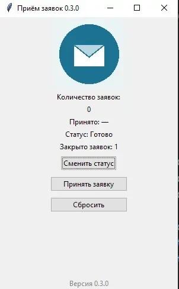

 # README.md
 ## Продукт
 Это мини приложения для кассиров в супер маркетах с огромным количепством покупателей
 1. в котором есть возможность доовлять количество заявок (максимум 11)
 2. изменять их статут (Новая - В работе - Готово ) при тройной смене статуса количисто закрытых заявок меняется на 1 
 3. а так же есть возможность сбрасывать количество принятых заявок (до нуля)

 
 # В данном репозитории
 В табличном формате выведенны частые обращения в службу поддержки
 